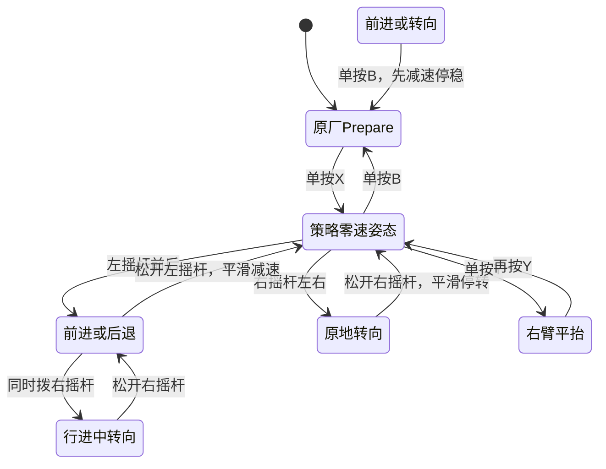

# T1 S68 比赛控制器

当前候选包：`T1_S68_COMPETITION_DEPLOY_20261011.zip`。它包含 S68 第 600 轮模型、80→21→23 关节适配、比赛手柄状态机、常驻服务、一键安装和回退脚本。S62 包仍保留，随时可以回退。

## 一键部署

把 ZIP 复制到机器人感知板并解压，只执行：

```bash
cd T1_S68_COMPETITION_DEPLOY
sudo bash install_s68.sh
```

脚本会核对模型哈希、80 维观察、21 维动作和 23 关节映射，然后安装并启动 `t1-s68-competition.service`。服务在机器人上常驻，SSH 或网线断开不会中断手柄控制。安装 S68 时会停止已运行的 S62/S46 自定义服务，不覆盖原厂 Booster 程序。

退出 S68 并恢复安装前的自定义服务：

```bash
sudo bash rollback_s68.sh
```

## 手柄逻辑



- `X`：从原厂 Prepare 平滑接管并进入策略零速姿态；姿态稳定前屏蔽摇杆命令。
- 左摇杆前后：前进、后退；松杆后留在策略零速姿态。
- 右摇杆左右：原地转向或行进中修正，带独立的角加速度和角加加速度限制。
- `Y`：只在零速时把右肩俯仰平滑移动到 −1.57 rad，再按一次放下；不绑定行走动作。
- `B`：先把速度和转向降到零，再回原厂 Prepare；服务继续等待下一次 `X`。
- `A`：空闲。按住 `LT` 或 `RT` 时，面键留给原厂组合键。

控制上限：前进 1.6 m/s、后退 1.0 m/s、转向 0.5 rad/s；前进加速度 0.5 m/s²、加加速度 1.5 m/s³；转向角加速度 0.4 rad/s²、角加加速度 1.2 rad/s³。

## S68 模型

模型：`CorrectionFlip S68` 第 600 轮。TorchScript SHA256：`3cf424a07c0037572be1954d928201006f8634cf0f7c151b6ff2078b46ddacb7`。

| 仿真项目 | 结果 |
| --- | ---: |
| 1.6 m/s 指令下 60 秒实速 | 1.414 m/s |
| 60 秒累计横漂 | +0.091 m |
| 力矩请求触限步占 | 2.2% |
| 关节速度触限 | 0% |
| 摆脚边缘离地均值 | 11.3 mm |
| 零速脚距 | 0.261 m |
| 左右膝差 | 0.0002 rad |
| 标准动态序列 | 32/32 |
| 零速四向推扰 | 128/128 |
| 连续左右微调＋移动推扰 | 252/256 |
| 连续左右微调、无外力 | 248/256 |

三视角连续微调视频位于 `videos/S68_model600_manual_three_views.mp4`。视频序列为零速、平滑加速、左修正、右修正、松转向回正和继续直行。

## 现场一次完成的检查

1. 固件使用已验证的 v1.8.0.9；机身急停弹起，电池锁扣和关节线束固定。
2. 执行安装命令，确认 `t1-s68-competition.service` 为 `active (running)`。
3. 用原厂按键进入 Prepare；单按 `X`，等待约 2 秒。
4. 连续检查前进、后退、左右原地转向、行进中左右微调、松杆再走、`Y` 抬臂和 `B` 回 Prepare。
5. 日志：`sudo journalctl -u t1-s68-competition.service -f` 或 `tail -f ~/t1_s68_competition/runtime.log`。

## 第一次接网线

机器人开机后等待约 60～90 秒。电脑有线网口设为 `192.168.10.200/24`，依次检查运控板 `192.168.10.101` 和感知板 `192.168.10.102`。`.101` 先通、`.102` 稍后才通属于正常启动过程。程序启动后至少等待 2 秒再调用模式接口；错误码 100 时每隔 1 秒重试，最多三次。

当前包已通过离线模型契约、状态机和压缩包完整性检查。上述运动指标来自仿真，首次上机仍从有人扶持的连续功能检查开始。
